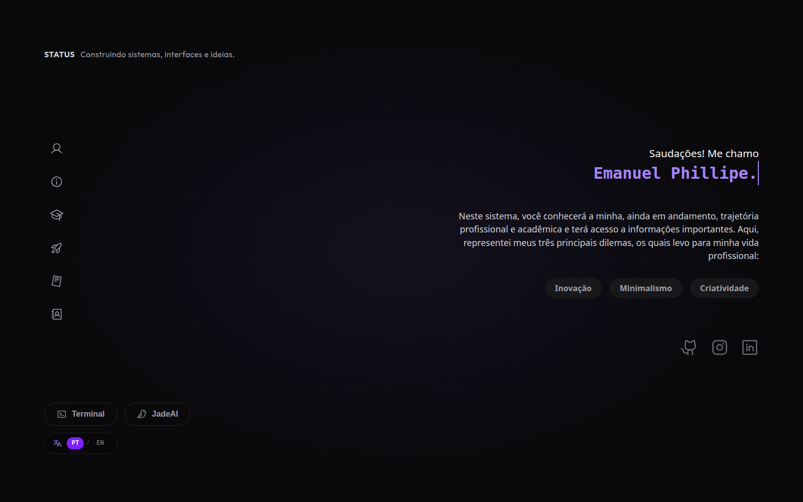
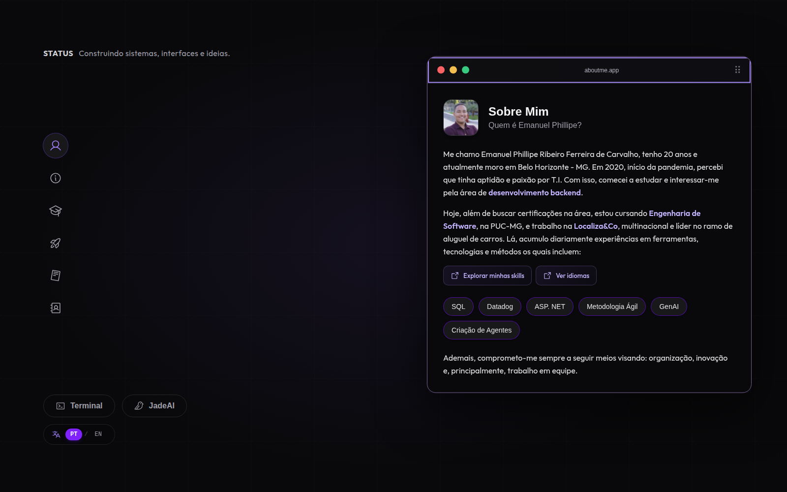
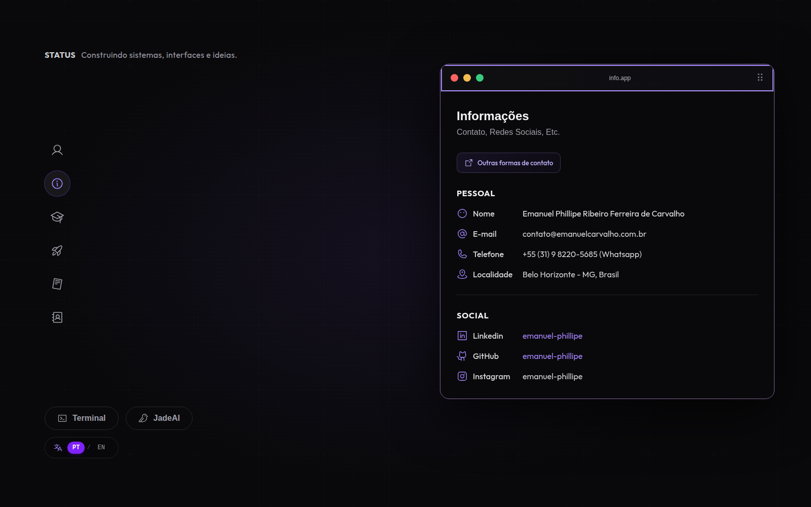
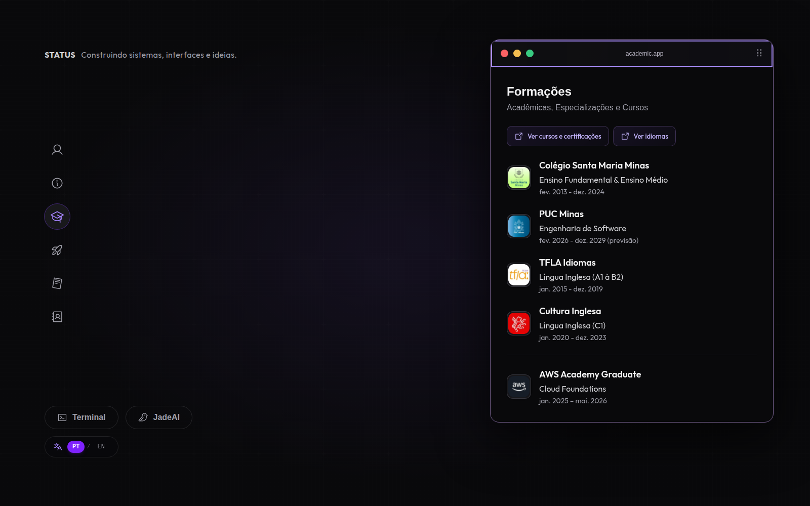
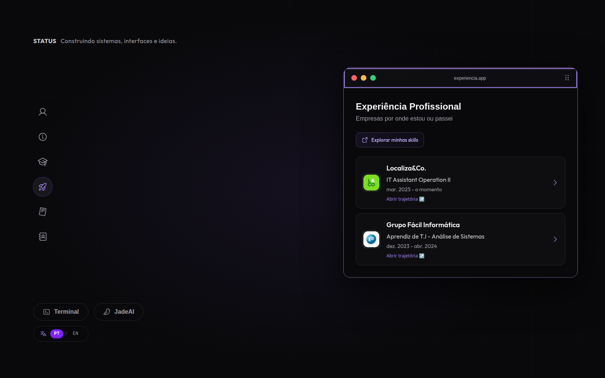
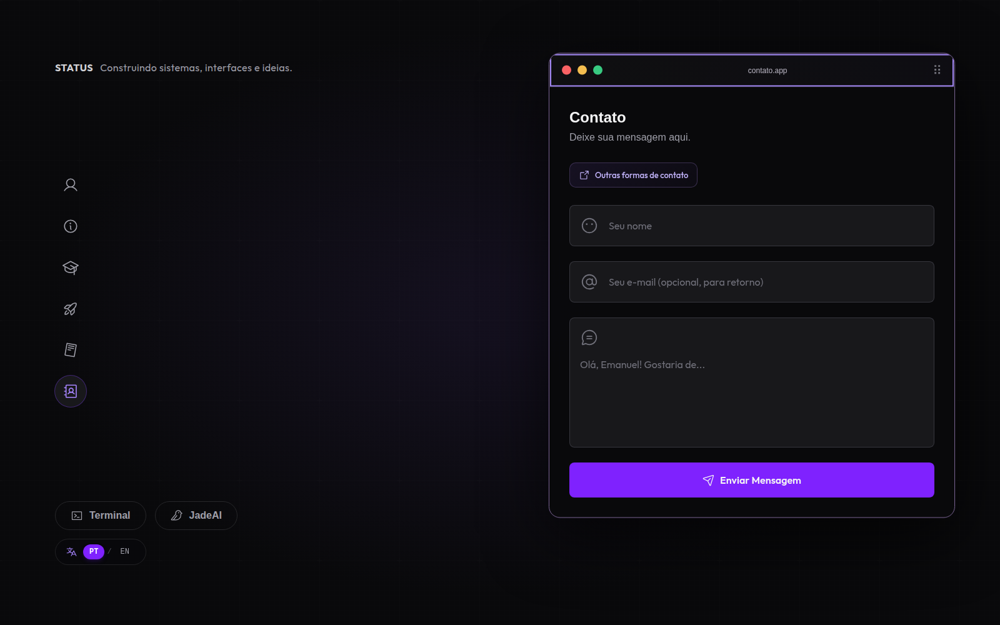

# Space Emanuel

Portfólio pessoal de Emanuel Phillipe, apresentado como um espaço de trabalho interativo. A interface reúne informações profissionais e acadêmicas em janelas que lembram um desktop, com uma navegação adaptada para dispositivos móveis.

**Acesse:** [space.emanuelphillipe.com](https://space.emanuelphillipe.com)

## Funcionalidades

- **Página inicial:** apresentação, pilares profissionais e links para GitHub, Instagram e LinkedIn.
- **Sobre mim:** biografia, tecnologias e atalhos para competências e idiomas.
- **Informações:** dados de contato e redes sociais, com links diretos para e-mail e WhatsApp.
- **Formações:** histórico acadêmico, cursos e certificações.
- **Experiência:** empresas, cargos e períodos, com janelas de detalhes para cada experiência.
- **Currículo:** visualizador de PDF com navegação entre páginas, zoom, opção para abrir em outra aba e download.
- **Contato:** formulário de mensagem integrado ao EmailJS.
- **Terminal interativo:** atalhos de navegação e comandos `help`, `open`, `self` e `clear`. É um terminal próprio da interface; não executa comandos do sistema.
- **Jade:** janela de perguntas e respostas sobre o perfil, com respostas selecionadas por palavras-chave.
- **Janelas interativas:** mover, minimizar, maximizar, restaurar, focar e fechar janelas; também é possível movê-las pelo teclado.
- **Português e inglês:** alternância de idioma com preferência salva no navegador.
- **Layout responsivo:** navegação dedicada para desktop e celular.

## Interfaces

As capturas abaixo mostram as telas principais em português.

### Início

<p align="center">
  
</p>

<p align="center">
  
</p>

### Seções do portfólio

<details>
  <summary>Sobre mim</summary>
  <p align="center"></p>
</details>

<details>
  <summary>Informações</summary>
  <p align="center"></p>
</details>

<details>
  <summary>Formações</summary>
  <p align="center"></p>
</details>

<details>
  <summary>Experiência</summary>
  <p align="center"></p>
</details>

<details>
  <summary>Contato</summary>
  <p align="center"></p>
</details>

O currículo aparece em um visualizador próprio com controles de zoom e paginação. As janelas **Terminal** e **Jade** são acessadas pelos controles no rodapé da interface.

## Bibliotecas e ferramentas

| Área | Bibliotecas |
| --- | --- |
| Interface | React 19, React DOM e TypeScript |
| Desenvolvimento e build | Vite, `@vitejs/plugin-react`, `@tailwindcss/vite` e Tailwind CSS 4 |
| Rotas | TanStack Router |
| Estilos e animações | Tailwind CSS, `tailwindcss-motion` e Motion |
| Ícones | Phosphor Icons (`@phosphor-icons/react`) |
| Idiomas | i18next, `react-i18next` e `i18next-browser-languagedetector` |
| PDF | `react-pdf` e `pdfjs-dist` |
| Formulário | `@emailjs/browser` |
| Qualidade e testes | ESLint e `node:test` |

## Como executar

### Pré-requisitos

- Node.js `^20.19.0` ou `>=22.12.0`.
- pnpm.

### Instalação e desenvolvimento

```bash
pnpm install
pnpm dev
```

O Vite informa no terminal o endereço local para abrir no navegador (por padrão, `http://localhost:5173`).

### Configuração do formulário de contato

O formulário envia mensagens pelo EmailJS. Para habilitar o envio no ambiente local, crie um arquivo `.env.local` na raiz do projeto e configure os identificadores e a chave pública da sua conta:

```dotenv
EMAILJS_SERVICE=seu_service_id
EMAILJS_TEMPLATE=seu_template_id
EMAILJS_PUBLIC=sua_public_key
```

Sem essas variáveis, o formulário mostra um aviso de configuração. A aplicação usa a chave pública do EmailJS no navegador; não coloque chaves privadas no frontend.

### Build e outros comandos

```bash
pnpm build     # verifica os tipos TypeScript e gera a versão de produção em dist/
pnpm preview   # serve localmente o build gerado
pnpm lint      # executa o ESLint
pnpm test      # executa os testes em tests/*.test.ts
```

## Estrutura do projeto

```text
src/
├── components/  # elementos reutilizáveis, incluindo janelas e botões
├── context/     # estado das janelas e modais
├── device/      # composições para desktop e celular
├── i18n/        # traduções em português e inglês
├── lib/         # utilitários, como limites de movimentação de janelas
├── sections/    # navegação, layout e área de conteúdo
└── widgets/     # telas, janelas de detalhe e modais
docs/
└── screenshots/ # capturas de tela usadas neste README
```
